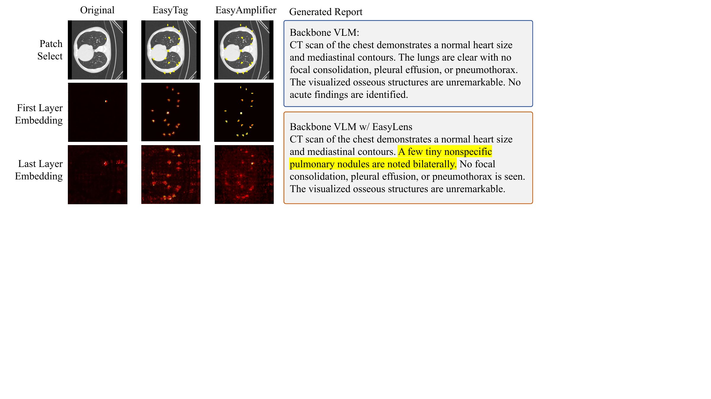

# EasyLens

**EasyLens: A Training-Free Plug-and-Play Subtle-Lesion Representation Amplifier for Medical Vision-Language Models**

EasyLens is an inference-time adapter for frozen medical vision-language models (VLMs). It improves sensitivity to subtle lesions by selecting lesion-relevant visual tokens and amplifying their representations before the frozen VLM consumes the visual sequence. It does not fine-tune the backbone, does not change the decoder, and does not require lesion masks at inference time.

<p align="center">
  
</p>

## Highlights

- **Training-free**: EasyLens operates on frozen VLM embeddings and requires no gradient updates.
- **Plug-and-play**: the same EasyTag and EasyAmplifier mechanism can be attached to multiple medical VLM backbones.
- **Prototype-guided**: EasyBank stores lesion-related prototypes and anatomy-aware normal references for counterfactual patch selection.
- **Morphology-aware**: selected lesion evidence is propagated and enhanced with morphology-guided residual updates.
- **Subtle-lesion focused**: the packaged benchmark covers ReXGroundingCT, LIDC-IDRI, and AbdomenAtlas-style CT tasks for lesion statistics, region selection, and report generation.

## Method

EasyLens contains three components.

1. **EasyBank** builds an offline pathology-anatomy prototype space from reference images and lesion masks. It stores lesion-related prototypes, location-aware normal prototypes, lesion support memories, and morphology priors.
2. **EasyTag** selects lesion-relevant visual patches at inference time by comparing each patch against both pathological prototypes and location-matched normal references.
3. **EasyAmplifier** moves selected visual tokens toward lesion-support directions through score-weighted residual enhancement, while preserving the original visual context.

<p align="center">
  
</p>

## Repository Layout

```text
.
├── benchmarks/              # Text metadata for 9 subtle-lesion benchmarks
├── benchmark_sample_ids/    # Sample id lists for benchmark traceability
├── banks/                   # EasyBank manifest and checksums; bank .pt files come from the release bundle
├── code/
│   ├── runners/             # Official runners and scorers
│   ├── method/              # EasyLens construction and utility code
│   ├── dependencies/        # Local helper modules used by the runners
│   └── launch_scripts/      # Shell entry points
└── configs/                 # Official parameter settings and benchmark counts
```

The GitHub repository keeps code, benchmark metadata, sample ids, bank manifests, and reproducibility configuration. The full benchmark images and `.pt` bank files are distributed separately because they are large.

## Download Benchmark Images and Banks

The full release bundle contains:

- 9 benchmark folders with images, questions, and answers.
- 7 EasyBank `.pt` files for the packaged subtle-lesion MedGemma1.5 pipeline.
- the same code/config structure as this repository.

Download from Google Drive:

```text
https://drive.google.com/open?id=1xwcLkQgnQUtZ6Hdoaj-jgfhDLufsccG2
```

Direct download URL:

```text
https://drive.google.com/uc?id=1xwcLkQgnQUtZ6Hdoaj-jgfhDLufsccG2&export=download
```

Recommended command-line download:

```bash
pip install gdown
gdown --id 1xwcLkQgnQUtZ6Hdoaj-jgfhDLufsccG2 -O easylens_release_with_banks_images_20260511.tar
```

Extract:

```bash
mkdir -p data
tar -xf easylens_release_with_banks_images_20260511.tar -C data
```

After extraction:

```text
data/easylens_release_with_banks_images_20260511/
├── benchmarks/
│   ├── rex_count/
│   ├── rex_single_select/
│   ├── rex_report/
│   ├── lidc_count/
│   ├── lidc_single_select/
│   ├── lidc_report/
│   ├── abdomen_count/
│   ├── abdomen_single_select/
│   └── abdomen_report/
└── banks/
    └── subtle_lesion_medgemma15/
```

The packaged bank files are:

```text
banks/subtle_lesion_medgemma15/rex_count_select_shape_bank.pt
banks/subtle_lesion_medgemma15/rex_report_shape_bank.pt
banks/subtle_lesion_medgemma15/lidc_count_report_shape_bank.pt
banks/subtle_lesion_medgemma15/lidc_single_select_shape_bank.pt
banks/subtle_lesion_medgemma15/abdomen_count_shape_bank.pt
banks/subtle_lesion_medgemma15/abdomen_single_select_shape_bank.pt
banks/subtle_lesion_medgemma15/abdomen_report_shape_bank.pt
```

You can verify the bank files with:

```bash
cd data/easylens_release_with_banks_images_20260511
sha256sum -c banks/subtle_lesion_medgemma15/SHA256SUMS
```

On macOS:

```bash
cd data/easylens_release_with_banks_images_20260511
shasum -a 256 -c banks/subtle_lesion_medgemma15/SHA256SUMS
```

## Benchmark Summary

| Dataset | Stat. / Count | Sel. | Gen. |
|---|---:|---:|---:|
| ReXGroundingCT | 147 | 90 | 60 |
| LIDC-IDRI | 132 | 133 | 60 |
| AbdomenAtlas-style CT | 86 | 104 | 50 |

Task definitions:

- **Stat. / Count**: predict the number of grid cells containing lesion evidence.
- **Sel.**: select the lesion-containing region from candidate grid locations.
- **Gen.**: generate a report or score lesion-token probabilities under report-generation prompts.

<p align="center">
  
</p>

## Build EasyBank from Your Own Data

If you want to build EasyBank instead of using the packaged bank files, prepare a prototype construction split with medical images and lesion masks. Masks are used only for offline bank construction and are not needed at inference time.

Set paths:

```bash
export MODEL_PATH=/path/to/medgemma-1.5-4b-it
export BANK_SOURCE_ROOT=/path/to/bank_construction_split
export BANK_ROOT=./banks/subtle_lesion_medgemma15
```

Build banks:

```bash
bash code/launch_scripts/build_subtle_lesion_banks_medgemma15.sh
```

The resulting bank directory should contain the `.pt` files listed above and the corresponding `MANIFEST.json` / `SHA256SUMS` records.

## Run Inference with Packaged Banks

Use the official runner with the extracted benchmark images and banks:

```bash
export MODEL_PATH=/path/to/medgemma-1.5-4b-it
export DATA_ROOT=./data/easylens_release_with_banks_images_20260511

python code/runners/easylens_official_runner.py subtle-medgemma15 \
  --model-path "$MODEL_PATH" \
  --benchmark-root "$DATA_ROOT/benchmarks" \
  --bank-root "$DATA_ROOT/banks/subtle_lesion_medgemma15" \
  --output-root outputs/subtle_lesion_medgemma15
```

The runner reads task-specific EasyLens settings from:

```text
configs/official_runner_config.json
```

Important shared settings include:

```text
vision_layer = 1
support_mode = global_topk
seed_mode = local_peak_topk
seed_peak_kernel = 5
suppression_radius = 1
margin_weight = 0.35
shape_weight = 1.0
score_threshold = 0.0
retrieval_temperature = 0.1
```

Task-specific settings include:

```text
beta
selector_k
seed_topk
retrieval_topm
support_score_mode
bank_file
```

These parameters define the interface operating point for a dataset-task pair. They do not update the backbone model and are applied uniformly to all samples in the corresponding benchmark.

## Reproduce the Packaged Subtle-Lesion Evaluation

The release bundle already includes benchmark images and banks. A typical reproduction workflow is:

```bash
git clone https://github.com/wanghao1118/easylens.git
cd easylens

pip install gdown
gdown --id 1xwcLkQgnQUtZ6Hdoaj-jgfhDLufsccG2 -O easylens_release_with_banks_images_20260511.tar
mkdir -p data
tar -xf easylens_release_with_banks_images_20260511.tar -C data

export MODEL_PATH=/path/to/medgemma-1.5-4b-it
export DATA_ROOT=./data/easylens_release_with_banks_images_20260511

python code/runners/easylens_official_runner.py subtle-medgemma15 \
  --model-path "$MODEL_PATH" \
  --benchmark-root "$DATA_ROOT/benchmarks" \
  --bank-root "$DATA_ROOT/banks/subtle_lesion_medgemma15" \
  --output-root outputs/subtle_lesion_medgemma15
```

## Qualitative Examples

EasyLens aims to expose weak lesion evidence that is already present in patch-level embeddings but can be diluted during global aggregation.

<p align="center">
  
</p>

In qualitative cases, EasyTag selects candidate lesion patches and EasyAmplifier strengthens their lesion-related representation before report generation.

<p align="center">
  
</p>

## Notes on Data and Model Assets

- The benchmark bundle contains rendered benchmark images, questions, answers, and EasyBank files used by the packaged runner.
- Original medical datasets and model checkpoints may have their own licenses or access requirements. Users should obtain model weights and any restricted source datasets from their original providers.
- EasyLens is a research prototype for evaluating subtle-lesion perception. It is not a standalone clinical diagnostic system.

## Citation

```bibtex
@article{easylens2026,
  title={EasyLens: A Training-Free Plug-and-Play Subtle-Lesion Representation Amplifier for Medical Vision-Language Models},
  year={2026}
}
```

