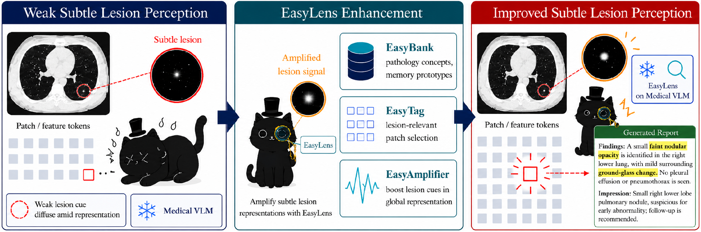
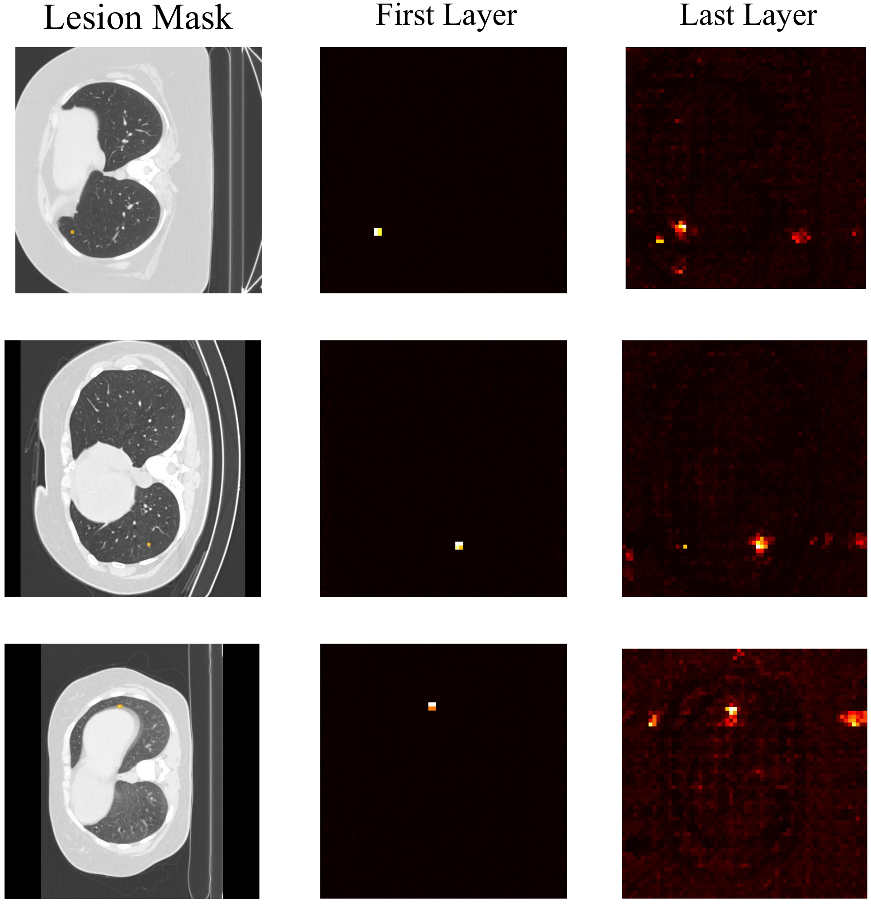
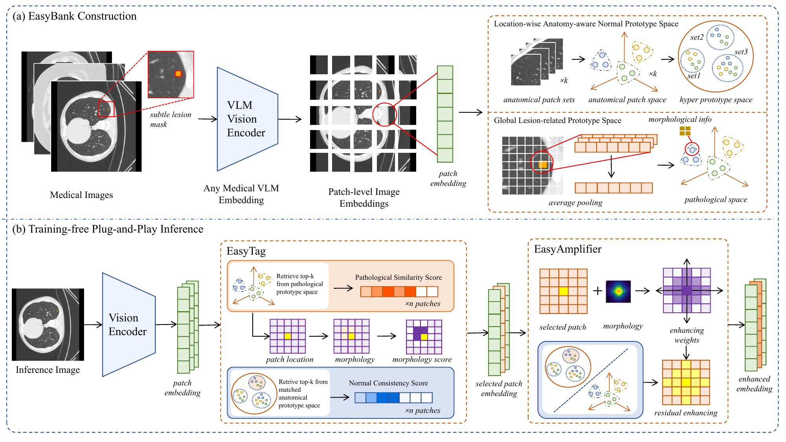
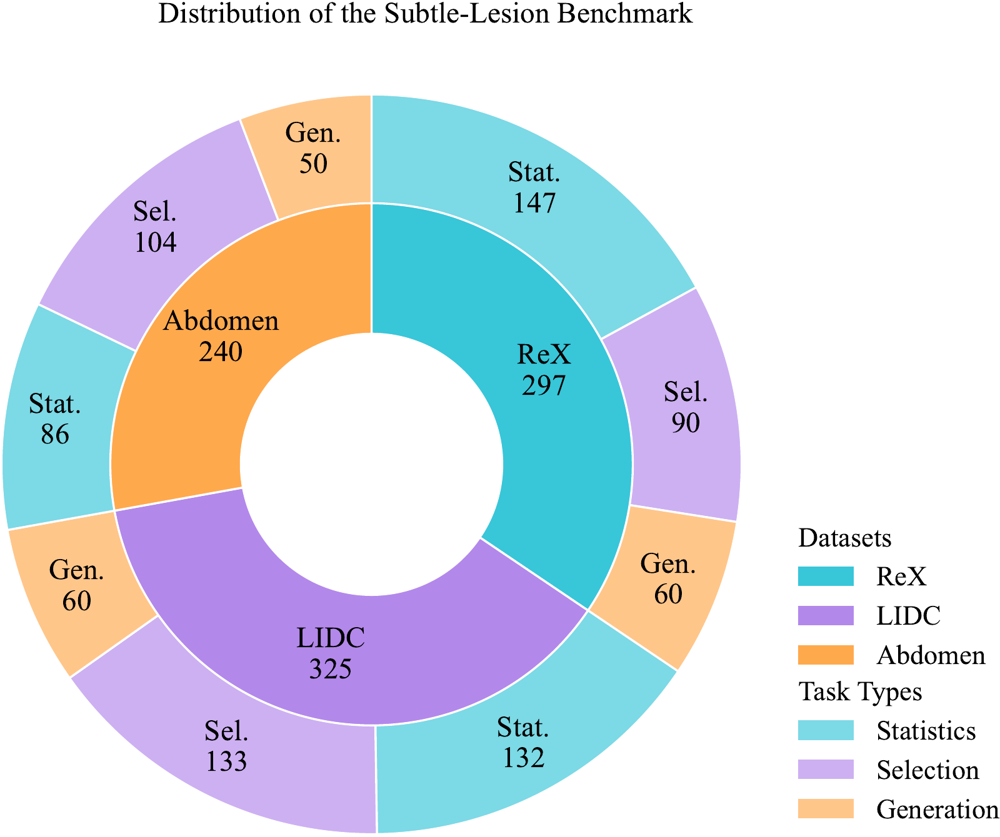
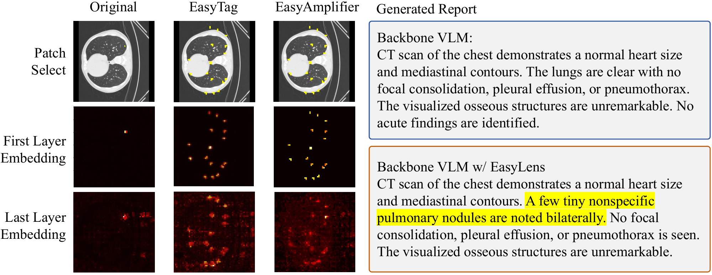

<div align="center">

<h1>EasyLens: A Training-Free Plug-and-Play Subtle-Lesion Representation Amplifier for Medical Vision-Language Models</h1>

<p>
  <a href="https://arxiv.org/abs/2606.06379"></a>
  <a href="https://arxiv.org/pdf/2606.06379"></a>
</p>

<p>Qiwei Zeng, Hao Wang, Jinghao Lin, Shuchang Ye, Yuezhe Yang,<br>
Yige Peng, Haoyuan Che, Jinman Kim, Lei Bi</p>

<p>Jilin University · The University of Sydney · Northeastern University · Shanghai Jiao Tong University</p>

</div>

## Overview

**EasyLens** is a training-free inference-time adapter that helps frozen medical vision-language models (VLMs) recognize subtle lesions. It builds an offline pathology-anatomy prototype bank, selects lesion-relevant visual patches, and strengthens their representations before the frozen VLM processes them. No backbone update or lesion mask is needed at inference time.



Small, low-contrast findings can be present in early patch representations but lose prominence as visual tokens are aggregated. EasyLens works at the patch level to keep that evidence visible.

<p align="center">
  
</p>

## Method



1. **EasyBank** builds lesion prototypes, prototype-specific support memories, morphology priors, and location-wise normal prototypes from an independent construction set.
2. **EasyTag** contrasts each inference patch with lesion and anatomy-matched normal prototypes, then selects candidates using counterfactual scores and morphology-aware calibration.
3. **EasyAmplifier** retrieves support from the selected lesion prototype and applies a morphology-guided residual update to the frozen visual tokens.

The equation-literal implementation is in [`code/method/easylens_core.py`](code/method/easylens_core.py). The public builder creates schema-v2 banks. Older schema-v1 banks remain readable for audit compatibility and are labeled `legacy_approximation` at runtime.

## Subtle-Lesion Benchmark

The released benchmark covers regional statistics (**Stat.**), region selection (**Sel.**), and lesion-aware report generation (**Gen.**) across three CT datasets. Its questions, answer labels, and sample lists are included in this repository.

| Dataset | Stat. | Sel. | Gen. |
|:--|--:|--:|--:|
| ReXGroundingCT | 147 | 90 | 60 |
| LIDC-IDRI | 132 | 133 | 60 |
| AbdomenAtlas 3.0 Mini | 86 | 104 | 50 |

<p align="center">
  
</p>

The 46 published benchmark metadata and sample-list files are pinned by [`configs/benchmark_source_manifest.json`](configs/benchmark_source_manifest.json). The paper figures above are illustrative assets; original dataset images, masks, raw reports, model weights, and EasyBank tensors are not redistributed here.

## Results

The following are **paper-reported** scores for MedGemma1.5 before and after EasyLens. Each cell shows **frozen backbone -> EasyLens**; higher is better. See [Table 1 of the paper](https://arxiv.org/html/2606.06379v3) for metric definitions and comparisons with other models.

| Dataset | Stat. | Sel. | Gen. |
|:--|:--:|:--:|:--:|
| ReXGroundingCT | 42.86 -> **66.67** | 23.33 -> **31.11** | 4.41 -> **5.15** |
| LIDC-IDRI | 20.45 -> **30.30** | 27.82 -> **36.09** | 41.93 -> **45.86** |
| AbdomenAtlas 3.0 Mini | 15.12 -> **52.33** | 49.04 -> **55.77** | 38.18 -> **40.67** |

The paper also evaluates transfer to LLaVA-Med, RadFM, Lingshu, and MedGemma, and reports gains in subtle-lesion report generation across these frozen backbones. These table values are paper results; locally rebuilt banks are not the historical artifacts used to produce them.

## Qualitative Analysis

In the paper's pulmonary-nodule case study, EasyTag selects lesion-relevant patches and EasyAmplifier strengthens their response. The EasyLens-enhanced model mentions the finding that the frozen backbone omits.



## Release Contents

| Path | Contents |
|:--|:--|
| [`code/method/`](code/method) | EasyLens core and bank-construction code |
| [`code/runners/`](code/runners) | Official evaluation and scoring entry points |
| [`code/launch_scripts/`](code/launch_scripts) | Bank-building and evaluation commands |
| [`benchmarks/`](benchmarks) | Nine benchmark definitions, prompts, and answer labels |
| [`benchmark_sample_ids/`](benchmark_sample_ids) | Published evaluation sample lists |
| [`banks/`](banks) | Bank schema notes and legacy artifact checksums, without tensors |
| [`configs/`](configs) | Task settings and benchmark provenance |
| [`tests/`](tests) | Synthetic method and release tests |

## Quick Start

Python 3.10 or newer and a CUDA-capable PyTorch installation are recommended. Model-specific backbones may require their upstream dependencies in addition to this repository's requirements.

```bash
git clone https://github.com/wanghao1118/EasyLens.git
cd EasyLens
python3 -m pip install -r requirements.txt
```

The repository includes benchmark metadata, but you must obtain the evaluation images and the model checkpoint from their original providers under the applicable access terms. Place authorized evaluation images at the relative paths referenced by `benchmarks/*/images/`.

## Build EasyBank

Provide an **independent construction split**, disjoint from evaluation. `BANK_SOURCE_ROOT` should contain `rex/`, `lidc/`, and `abdomen/`, each with a `manifest.csv`, aligned images, and pixel-level lesion supervision. The builder accepts `mask_path`, `mask`, or `raw_mask` fields for ordinary masks. ReX 4D segmentations and LIDC polygons can be supplied through `REX_RAW_ROOT` and `LIDC_SOURCE_MANIFEST`, respectively. Coarse VQA grid labels are not substitutes for lesion masks.

```bash
export MODEL_PATH=/path/to/medgemma-1.5-4b-it
export BANK_SOURCE_ROOT=/path/to/independent_construction_split
export BANK_ROOT=/path/to/banks/subtle_lesion_medgemma15
export REX_RAW_ROOT=/path/to/authorized/rex/raw
export LIDC_SOURCE_MANIFEST=/path/to/authorized/lidc_source_manifest.csv

bash code/launch_scripts/build_subtle_lesion_banks_medgemma15.sh
```

This produces one schema-v2 `.pt` bank per dataset: `rex_shape_bank_v2.pt`, `lidc_shape_bank_v2.pt`, and `abdomen_shape_bank_v2.pt`. The Stat., Sel., and Gen. tasks for a dataset share its bank. Construction samples and bank tensors are not part of the public release.

## Run Evaluation

```bash
python3 code/runners/easylens_official_runner.py subtle-medgemma15 \
  --model-path /path/to/medgemma-1.5-4b-it \
  --benchmark-root /path/to/benchmarks \
  --bank-root /path/to/banks/subtle_lesion_medgemma15 \
  --output-root outputs/subtle_lesion_medgemma15
```

Use `--tasks rex_count rex_single_select rex_report` to run only selected tasks. The packaged operating points are in [`configs/official_runner_config.json`](configs/official_runner_config.json); its `paper_equations_27_40` method profile uses global candidate selection and prototype-consistent support retrieval.

For ReX report generation, the published binary answer alone does not contain the target description required by the paper's lesion-token probe. If you have authorized access to the source manifest, prepare a local evaluation copy first:

```bash
python3 code/tools/prepare_rex_report_targets.py \
  --source-manifest /path/to/authorized/rex/manifest.csv \
  --benchmark-dir benchmarks/rex_report \
  --output-dir /path/to/local/benchmarks/rex_report
```

Place the corresponding authorized images under that local benchmark's `images/` directory. The report probe evaluates the first three decoding steps. Its vocabulary top-K is set to 50 in this release configuration; the paper defines top-K without fixing a numeric value.

## Research Use

EasyLens is a research prototype, not a standalone clinical diagnostic system. Users are responsible for dataset access, privacy, licensing, and clinical validation. Apart from the paper figures in `assets/`, the release contains no original dataset images, masks, raw reports, model checkpoints, selector weights, or EasyBank tensors.

## Citation

If EasyLens is useful in your research, please cite the [paper](https://arxiv.org/abs/2606.06379):

```bibtex
@article{easylens2026,
  title={EasyLens: A Training-Free Plug-and-Play Subtle-Lesion Representation Amplifier for Medical Vision-Language Models},
  author={Zeng, Qiwei and Wang, Hao and Lin, Jinghao and Ye, Shuchang and Yang, Yuezhe and Peng, Yige and Che, Haoyuan and Kim, Jinman and Bi, Lei},
  journal={arXiv preprint arXiv:2606.06379},
  year={2026},
  eprint={2606.06379},
  archivePrefix={arXiv},
  primaryClass={cs.CV},
  doi={10.48550/arXiv.2606.06379},
  url={https://arxiv.org/abs/2606.06379}
}
```
